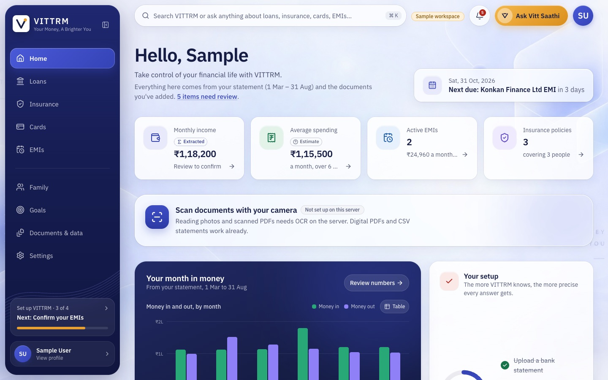
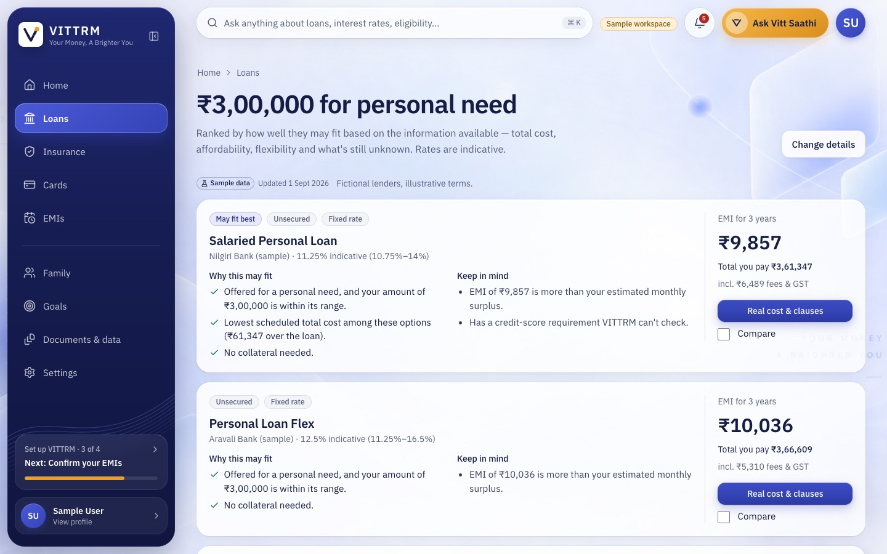
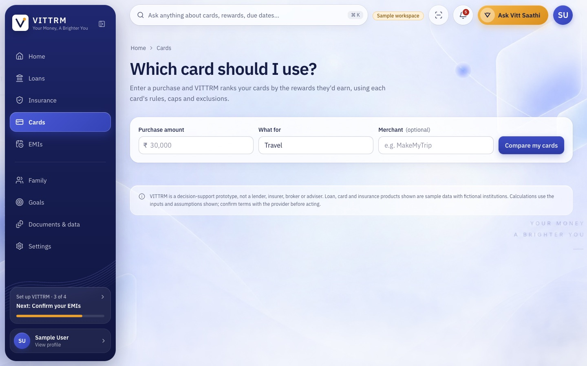
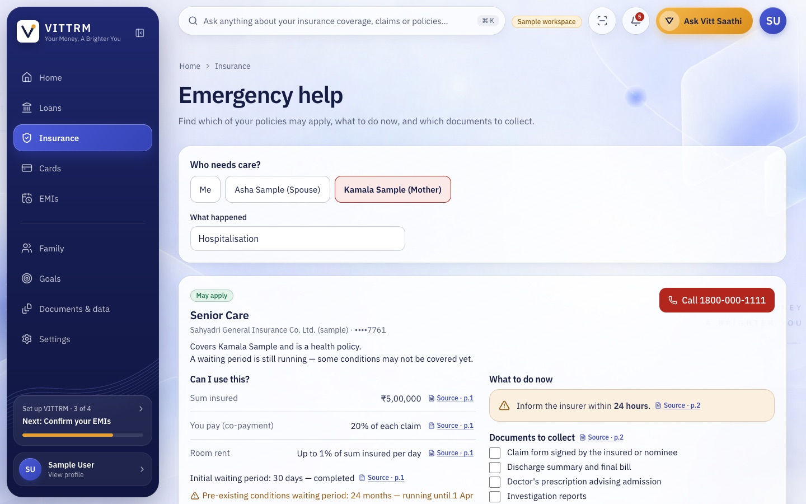

# VITRAM

[](https://github.com/pankajbaid567/vitram/actions/workflows/ci.yml)

An AI-assisted financial companion for salaried people in India: **loans, cards, EMIs and insurance** from one financial profile built out of your own bank statements and documents, with **Vitt Saathi (वित्त साथी)** as the single assistant.

> The app's on-screen brand is **VITRAM**; VITRAM is the project name.
> **Decision-support prototype.** All *priced* loan, card and insurance data is fictional sample data, labelled as such. The lists of real cards and insurance products are **reference-only** (names and official links, with no fees or benefits invented). VITRAM is not a lender, insurer, broker or adviser.

**Live demo (free tier):** https://vitram.baidpankaj567.workers.dev. Press *Open sample workspace* on the sign-in page, no sign-up needed. The first load after
a quiet period can take up to a minute while the free API wakes up.

Runs entirely on free plans: Cloudflare Worker (app + `/api` proxy) → Render (API) → Neon PostgreSQL, uploads in Cloudflare R2, optional OpenWA WhatsApp
gateway. See [`docs/DEPLOY.md`](docs/DEPLOY.md).

| | |
|---|---|
|  |  |
|  |  |

## What makes it different

- **Numbers you can trust.** EMI, real cost (scheduled vs contingent charges), prepayment, missed-payment and reward maths are pure, versioned functions, verified against independent recomputation. The assistant can only *narrate* their output; an amount in a model reply that doesn't match a tool result to the paise is replaced. Unknown terms give "not computable", never an invented fee.
- **Every fact opens its source.** Values extracted from statements, policies and loan documents carry document, page, snippet and confidence, and can be corrected by the user.
- **Consent where it matters.** Outbound WhatsApp is re-checked against consent and a verified phone *at send time*; `STOP` wins immediately.
- **Honest about what it can't do.** Missing integrations show *not configured*, never a fake success. See [`docs/STATUS.md`](docs/STATUS.md) for exactly what has and hasn't been verified, and `python -m app.doctor` to check your own setup.
- **Yours to take with you.** Download everything held about you as JSON, or delete the account and every file under it.

## Journeys

| Journey | What you get |
|---|---|
| **Profile** | Upload a CSV/PDF statement (or a photo of one) → income, categories, merchants, recurring payments, review & correct |
| **Loans** | Ranked, reason-coded options → real cost → compare → what-ifs; ask questions of a loan key-facts document with page citations |
| **Cards** | Best card for a purchase using each card's caps, exclusions and reward value; due dates; card-statement import, and confirmed purchases that count toward reward caps (reversibly) |
| **EMIs** | Detected or manual EMIs, month/week calendar, missed-payment and prepayment scenarios, in-app and WhatsApp reminders |
| **Insurance** | Policy documents → coverage, exclusions, waiting periods with sources; compare plans; **Emergency mode** scoped to one person |
| **Also** | Receipts, spending insights, cash-flow forecast, goals, family members, consultation requests |

## Run it

**Local (SQLite, no keys needed).** Python ≥ 3.11 with [uv](https://docs.astral.sh/uv/), Node ≥ 20. `make help` lists every task.

```bash
make install
make api      # backend → http://127.0.0.1:8000
make web      # frontend → http://localhost:5173 (proxies /api; port 8000 busy? API_PROXY_TARGET=http://127.0.0.1:8001 make web)
```

Open <http://localhost:5173> and choose **Open sample workspace** (generated fictional documents processed through the real pipeline), or create an account.

**Full stack in containers (PostgreSQL + API + reminder worker + nginx).**

```bash
cp .env.example .env     # then set VITRAM_DATA_KEY (command in the file)
make up                  # docker compose up --build → http://localhost:8080   (WEB_PORT to change)
```

**Check your integrations** after adding keys: `cd backend && uv run python -m app.doctor` (read-only; never prints a secret). Deploying and going live: [`docs/DEPLOY.md`](docs/DEPLOY.md), [`docs/GO_LIVE.md`](docs/GO_LIVE.md).

## Tests and quality gates

```bash
make ci          # ruff + oxlint + tsc + backend tests (88 % coverage) + frontend tests + build
make ci-linux    # the backend job in a Linux container
make e2e         # drive the demo path in Chrome (needs the app running)
make journey     # a brand-new user's whole journey in Chrome, at desktop and phone width
make a11y        # axe on every route + keyboard checks
make audit       # known-vulnerability scan of both dependency trees
```

CI runs all of it on every push, with the backend on SQLite **and** PostgreSQL. Results and what is *not* verified: [`docs/STATUS.md`](docs/STATUS.md).

## Database

SQLite (`backend/.data/vitram.db`) by default; set `DATABASE_URL` for PostgreSQL (`uv sync --extra postgres`). **Alembic** owns the schema (`backend/migrations`, `0001 → 0010`). Pending migrations apply at start-up (`AUTO_MIGRATE=true`) and an existing SQLite file is backed up first; in production set `AUTO_MIGRATE=false` and run `uv run alembic upgrade head` as a deploy step after a backup.

```bash
uv run python -m app.migrate status | backup | upgrade | restore <file>
uv run alembic revision --autogenerate -m "…"     # review before committing
```

## Integrations

All optional; configure through `.env` (see [`.env.example`](.env.example)).

| Integration | Enables | State |
|---|---|---|
| Gemini | Free-form assistant, consented scan OCR, live voice, opt-in AI-assisted extraction (each value must be quoted from its page) | Adapter tested with fakes; live use unverified. Without it the assistant runs in labelled *Tool mode* |
| WhatsApp: **Meta Cloud API** (production) or OpenWA (dev only) | EMI/card/renewal reminders, emergency quick-query, `STOP`. `WHATSAPP_PROVIDER` picks the adapter | Both verified against mocked HTTP through one shared test suite; **live use unverified**. OpenWA is unofficial, see [ADR-0002](docs/DECISIONS.md) |
| Twilio Verify / Voice | Phone possession check; insurance consultation calls | Gated and tested locally; no live SMS or call run |
| SMTP | E-mail verification and password reset | Tested with a fake mailer |
| Apple Vision (macOS) | On-device OCR for photos and scans | Verified on macOS |

Setup and the live-test checklist: [`docs/INTEGRATIONS.md`](docs/INTEGRATIONS.md).

## Documentation

| | |
|---|---|
| [`docs/ARCHITECTURE.md`](docs/ARCHITECTURE.md) | Layers, money path, pipeline, channels, security model, operations, failure behaviour, scaling path, testing |
| [`docs/DECISIONS.md`](docs/DECISIONS.md) | Architecture decision records (ADR-0001 … 0012) |
| [`docs/STATUS.md`](docs/STATUS.md) | What is verified, how, and what is not |
| [`docs/DEPLOY.md`](docs/DEPLOY.md) · [`docs/GO_LIVE.md`](docs/GO_LIVE.md) | Running it for real · plugging in keys and phone, step by step |
| [`docs/API.md`](docs/API.md) · [`docs/openapi.json`](docs/openapi.json) | API reference (generated, kept current by CI) |
| [`docs/INTEGRATIONS.md`](docs/INTEGRATIONS.md) · [`docs/DEMO.md`](docs/DEMO.md) | Provider setup · demo walkthrough |
| [`SECURITY.md`](SECURITY.md) · [`CONTRIBUTING.md`](CONTRIBUTING.md) | Controls and how to report · conventions |
| [`docs/spec/`](docs/spec) | Product requirements document, ideation page, historical plan |

## Layout

```
backend/    FastAPI · SQLAlchemy · Alembic · finance engine · document pipeline · Saathi · channels · worker · doctor
frontend/   React 19 · TypeScript · Vite · Tailwind v4 · Radix
docs/       architecture, decisions, status, deploy, go-live, API, integrations, demo, spec
deploy/     Render and Fly.io blueprints (config only)
.github/    CI, Dependabot
```
