# Architecture

VITRAM turns a salaried user's bank statements and policy/loan documents into a structured financial profile, then answers loan, card, EMI and insurance questions from that profile. The design rule that shapes everything: **language models explain, deterministic code computes, and every material number carries its source.**

```mermaid
flowchart LR
  subgraph Browser
    SPA[React SPA<br/>ErrorBoundary · React Query]
  end
  subgraph API["FastAPI"]
    R[Routers<br/>HTTP edge: auth, validation, serialisation]
    S[Services<br/>business rules]
    F[Finance engine<br/>pure functions]
    D[(SQLAlchemy · Alembic)]
  end
  subgraph W["Worker (python -m app.worker)"]
    L[Reminder loop<br/>claims due rows]
  end
  SPA -- "/api (session cookie, Origin-checked)" --> R
  R --> S --> D
  S --> F
  L --> S
  L -. heartbeat .-> D
  S -- "port: WhatsAppGateway" --> WA[(Meta Cloud API · OpenWA<br/>adapters)]
  S --> TW[(Twilio Verify / Voice)]
  S --> GM[(Gemini, optional)]
  S --> OCR[(Apple Vision, on-device)]
  WA -- "signed, idempotent webhooks" --> R
  TW -- "signed status callbacks" --> R
  D --- DB[(SQLite dev · PostgreSQL prod)]
```



## Layers and the dependency rule

Dependencies point inward: `routers → services → models`; `services/finance` imports nothing from the app.

| Layer | Where | Responsibility | Must not |
|---|---|---|---|
| HTTP edge | `backend/app/routers/` | Authenticate, validate (Pydantic), call a service, shape the response | Hold business rules |
| Services | `backend/app/services/` | Business rules, orchestration, provider adapters | Know about HTTP requests |
| Finance engine | `services/finance/` | EMI, real cost, prepayment, missed payment, rewards. Pure, versioned (`formula_version`) | Touch the database or a model |
| Persistence | `models.py`, `db.py`, `migrations/` | 34 tables, Alembic chain `0001…0008` | Hide schema changes outside a migration |
| Cross-cutting | `security.py`, `audit.py`, `errors.py`, `deps.py` | Hashing/encryption/redaction, audit trail, stable error codes, current-user & consent | |

Stable error contract: every failure is `{ "error": { "code", "message", "field?" } }` (`errors.py`), so the UI branches on codes, never on prose.

## The money path: why numbers are trustworthy

1. A request reaches a router, which calls `services/recommend` or `services/finance`.
2. The finance engine returns numbers **plus** assumptions, missing inputs and a `formula_version`. Unknown terms yield `computable: false` and a list of what is missing. No fee is ever invented.
3. Vitt Saathi (the assistant) can only *call these tools* (allow-listed per page, `saathi/tools.py`). Gemini, when configured, narrates the tool output; `fidelity_flags` checks every ₹ amount in the model's reply against the tool output (paise-exact); on any mismatch the reply is replaced with a safe message and the calculated cards remain the source of truth. Without Gemini, "Tool mode" renders the same tool results deterministically.
4. Every document-derived fact stores `document / page / section / snippet / confidence / user_verified`, so any figure opens its source.

Verified by recomputing EMI, interest, tenure what-ifs and reward values independently of the app (see `docs/STATUS.md`).

## Document pipeline

`Ingest → Parse → Normalise → Validate → Persist → Serve` (`services/pipeline.py`), run as a background task with its own DB session. Stage and status are persisted, so the UI shows progress and offers *Retry* after a failure.

- **Parse**: CSV and text-PDF statements (`statements/`), policies, loan KFS and card statements (`extractors/`), photos and scans through `services/vision` (one interface, providers `macos` | `gemini` | `none`). The default is on-device Apple Vision; Gemini OCR sends the document to Google and is therefore an explicit opt-in.
- **Safety**: size and magic-byte checks, EXIF stripped and images re-encoded, duplicate detection by checksum, prompt-injection text is treated as content and excluded from structured facts.
- **At rest**: Fernet-encrypted objects under random keys (`storage.py`); original filenames never reach the filesystem.
- **Retrieval** (`retrieval.py`): BM25 over page chunks and extracted facts, scoped to the user's own documents, with a field-label boost so *"waiting periods"* finds the waiting-period fact first. It answers `found: false` rather than guess.

## Channels: ports and adapters

`services/channels/gateway.py` defines the `WhatsAppGateway` protocol (`send_text`, `send_reminder`, `verify_signature`, `verify_subscription`, `session_matches`, `parse_webhook`). The scheduler and the webhook router depend on that protocol and on nothing vendor-specific; `gateway.whatsapp()` returns the adapter chosen by `WHATSAPP_PROVIDER`:

| Adapter | Use | Notes |
|---|---|---|
| `meta_cloud.py` | **production** (the spec's locked decision) | Reminders are *template* messages (`{{1}}` item, `{{2}}` amount, `{{3}}` date); free text only as a reply inside the 24-hour window. `X-Hub-Signature-256` over the raw body; `GET` handshake with a verify token; retryable vs. final errors mapped from Meta's codes |
| `openwa.py` | development/demo only | Unofficial, ban risk, dedicated number. Same contract, sends the rendered text |

One webhook route serves both (`POST /api/webhooks/whatsapp`; `/openwa` kept as an alias). A single parametrised test suite runs the same scenarios (signatures, STOP, replays, unknown senders, status ladder) against both adapters.

Outbound reminders (`scheduler.py`), run by the API process or, preferably, a dedicated worker:

```
schedule_for_user ──► reminders(status=scheduled)
                         │  claim_due(): UPDATE … WHERE status='scheduled' (atomic, committed first)
                         ▼
                      status=sending, claimed_at=now ──► dispatch()
                         │      ├─ re-check consent + verified phone at send time (STOP / opt-out wins)
                         │      ├─ in-app notification is always created
                         │      └─ gateway.send_reminder()  → sent | failed | back to scheduled (+backoff)
                         ▼
                      webhook receipts move sent → delivered → read (never backwards)
```

- **At-most-one sender per reminder**: the conditional `UPDATE` makes the database the arbiter, so several workers can share the table (a test races four threads over 24 reminders and asserts exactly 24 sends). A claim older than 5 minutes (a crashed worker) can be taken over.
- **Idempotent webhooks**: each event is recorded under a unique `(provider, external_id)`; a replay is a no-op (`idempotency.py`). Signatures are verified over the raw request bytes before anything is parsed.
- **Consent is checked where it matters, at send time**, not only when scheduling (`whatsapp_block_reason`), and `describe_dispatch` guarantees the UI never says "sent on WhatsApp" unless the gateway accepted the message. The settings API returns the same reason so the screen can explain *why* WhatsApp isn't active.
- Inbound messages are answered only for the *verified, opted-in* owner of a number (`inbound.py`); `STOP` revokes consent and downgrades queued WhatsApp reminders to in-app.

## Optional AI-assisted extraction (opt-in, bounded)

With `AI_EXTRACTION=true`, a model configured, and the user's `ai_processing` and `financial_documents` consents, `services/ai_extraction.py` asks the model to *propose* `{key, value, page, quote}` for a short allow-list of policy and loan fields. Plain code then accepts a proposal only if the quote appears **verbatim** on the cited page, **supports** the value (number, date or text is in it) and carries no injected instruction. Accepted values only **fill gaps**: deterministic facts always win, a disagreement becomes a warning for the user, and any failure falls back to pattern matching. Document text is framed to the model as data.

## Card spend reconciliation

Statement purchase rows are low-confidence, so nothing counts until the user confirms the row. Confirmed rows are mapped to a spend category and stored in `UserCard.imported_spend` (with provenance), **separate** from what the user typed; reward caps use the sum. It is previewable, undoable, withdrawn when the statement is deleted, and replacing a previous statement needs explicit consent (`services/card_spend.py`).

## Data model (36 tables, by area)

Identity & consent (`users`, `sessions`, `consents`, `auth_tokens`, `password_resets`, `audit_events`) · Documents (`documents`, `document_chunks`, `document_facts`) · Profile (`transactions`, `recurring_groups`, `financial_profiles`, `profile_overrides`, `bank_accounts`) · Journeys (`user_loans`, `emis`, `user_credit_cards`, `user_policies`, `policy_members`, `family_members`, `goals`, `expected_payments`) · Catalogues (`loan_catalogue`, `credit_card_catalogue`, `insurance_catalogue`) · Assistant (`conversations`, `messages`, `calculation_runs`) · Channels & operations (`reminders`, `reminder_preferences`, `notifications`, `consultation_requests`, `webhook_events`, `worker_heartbeats`, `rate_limit_hits`).

## Failure behaviour

| Failure | Behaviour |
|---|---|
| Gemini down / unset | Falls back to labelled Tool mode; provider is cooled off for 60 s |
| WhatsApp gateway 5xx / timeout | Reminder returns to `scheduled` with growing back-off (max 3 attempts); in-app notification kept |
| Worker dies mid-send | Claim expires after 5 min and another worker retries |
| Duplicate / replayed webhook | Ignored via the unique event key |
| Wrong-session or unsigned webhook | `204` (drop) / `401` |
| Document processing fails | Stage and error code persisted; *Retry* from the UI; saved work is untouched |
| One UI screen throws | `ErrorBoundary` shows a recoverable message; navigation resets it |
| Unexpected server error | stable `INTERNAL_ERROR` body with a `request_id`; details are logged, never returned |
| Reminder worker stalls | `/api/ready` reports the loop `stale`/`never_ran` (alert on it); the API keeps serving |
| Schema behind the code | `/api/ready` is `503`, so no traffic is routed to an un-migrated instance |
| Model proposes a value not on the page | rejected by the validator; the deterministic extraction stands |
| OCR unavailable | A clear "can't read scans here" error, never a silent empty result |

## Operations

- **Processes.** The API can run the reminder loop itself (default) or leave it to a dedicated worker: `RUN_SCHEDULER=false` + `python -m app.worker`. Several workers are safe (atomic claims). `docker compose up` starts PostgreSQL, API, worker and nginx.
- **Observability.** `X-Request-ID` on every response and log line (inbound ids reused when well-formed), `LOG_FORMAT=json`, redaction before formatting. `/api/health` (liveness) and `/api/ready` (database, schema revision, reminder-loop heartbeat from the `worker_heartbeats` table).
- **Rate limiting.** One interface, two backends: per-process memory (default) or the shared database (`RATE_LIMIT_BACKEND=database`), where each attempt is recorded before it is counted so racing requests can only be over-refused, never over-admitted.
- **Integration doctor.** `python -m app.doctor [--offline] [--json]` reports each integration as configured / reachable using read-only calls only, with secrets scrubbed from the output.
- **Backups.** `backend/scripts/backup.sh` and `restore.sh` cover PostgreSQL *and* the encrypted uploads; the key is backed up separately. See [`DEPLOY.md`](DEPLOY.md).

## Scaling path and known limits

- Uploads live on local disk (encrypted), so run **one API instance** until an object-storage adapter exists; workers and the database scale independently. `services/storage.py` is the only module that touches the filesystem.
- A broker is not needed at this scale; if reminder volume demands it, the claim logic moves behind a queue interface without touching callers.
- SQLite is the zero-setup default; production uses PostgreSQL. The migration chain and the whole suite run on both (and in Linux containers).
- Offline OCR is macOS-only (a Swift helper around Apple Vision); on Linux, scans need the opt-in Gemini provider and otherwise return a clear "can't read scans here".
- Retrieval is keyword-based BM25 with light stemming, not embeddings: precise for field questions, weaker for paraphrase.
- Catalogues: all *priced* data is **fictional sample data**; the real-institution lists are **reference-only** (names and official links, no invented numbers). Both are labelled and a contract test enforces it. A real provider can replace `load_catalogues()` without touching recommendation or calculation code.

## Testing strategy

| Layer | What |
|---|---|
| Backend unit/API (`backend/tests`, 500+ cases) | the finance engine against independent maths; every journey, with cross-user checks; document fixtures (statements, policies, KFS, scans, conflicting versions, injected text); channels (signatures, idempotency, status ladder, concurrent claims, STOP); migrations (fresh, legacy, downgrade, PostgreSQL JSON); security primitives; privacy export/delete |
| Contracts | `test_contracts.py` walks the journey routes (currency, precision, provenance, catalogue labels, citations, calculation snapshots); `test_access_matrix.py` is generated from the OpenAPI schema (every route authenticated or justified; every object route isolated) |
| Provider behaviour | adapters are tested against mocked HTTP built from the providers' documented shapes (Meta, OpenWA, Twilio, Gemini); the AI-extraction validator is tested with hostile proposals |
| Frontend (`src/__tests__`, vitest) | formatting, upload, scanner geometry, the API client, and journey tests that render the real route tree against **fixtures captured from the live API** (`make fixtures`), so a contract change breaks them |
| Browser | `e2e.mjs` drives the demo path in Chrome (verified to fail on the old crash); `a11y-audit.mjs` runs axe on every route plus keyboard checks |
| Pipeline | CI runs backend on SQLite and PostgreSQL, ruff, an API-docs freshness check, a dependency audit, the frontend checks, e2e and a11y. `make ci-linux` reproduces it locally |

Behaviour that needs a real phone or provider key is listed, not claimed, in [`STATUS.md`](STATUS.md).

## Repository layout

```
backend/    FastAPI · SQLAlchemy · Alembic · finance engine · pipeline · Saathi · channels
frontend/   React 19 · TypeScript · Vite · Tailwind v4 · Radix  (src/app = shell, routes, error boundary)
docs/       ARCHITECTURE · DECISIONS · STATUS · DEPLOY · GO_LIVE · INTEGRATIONS · API · DEMO · spec/
deploy/     Render and Fly.io blueprints (config only)
.github/    CI (backend on SQLite+PostgreSQL, audit, frontend, browser e2e + accessibility), Dependabot
```
